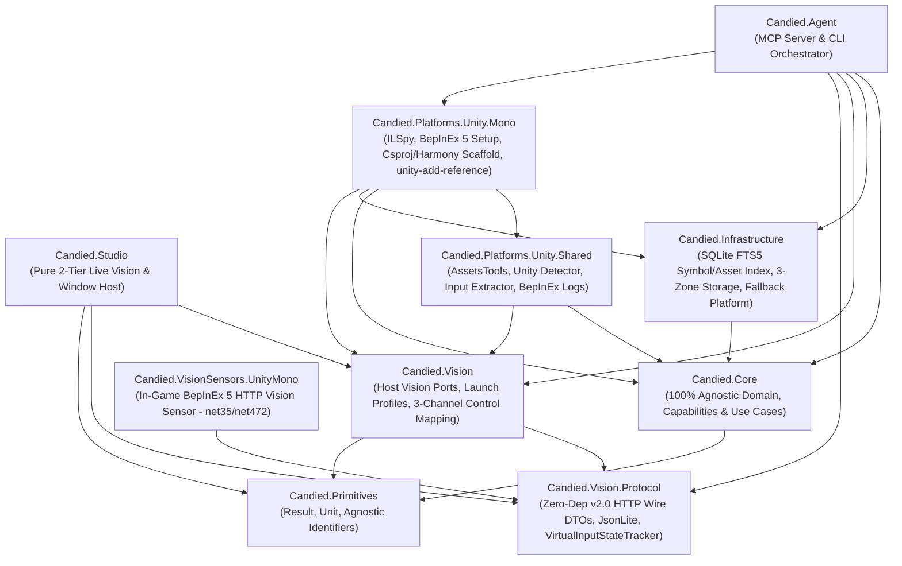

# Architecture Reference

## 1. Architectural Vision: Multi-Platform Modding & Pure 2-Tier Live Vision

Candied is architected around two strictly separated pillars:

1. **Composable Multi-Platform Modding & Reverse-Engineering Backbone (`Candied.Core` + `Candied.Infrastructure` + `Candied.Platforms.*`):**
   Models any game—whether a compiled PC title (Unity Mono, Unity IL2CPP, Unreal, custom C++), a scripted engine (Godot, Lua/LÖVE, RPG Maker), or a console ROM/ISO running inside an emulator (`targetPath` + `runnerPath`)—through a universal `TargetDescriptor` and optional, composable capability traits (`ITargetPlatform`).
2. **Pure Standalone 2-Tier Live Vision & Window Host (`Candied.Vision.Protocol` + `Candied.Vision` + `Candied.Studio`):**
   `Candied.Studio` is a **100% pure live vision and window-hosting application** with zero dependencies on `Candied.Core`, decompilers, SQLite symbol databases, or mod build toolchains:
   * **Tier 1 (`BaseWindow`):** Works out-of-the-box on *any* Win32 game or emulator window via Job Object containment, `HWND` embedding, Win32 `PrintWindow`/`BitBlt` frame capture, and 3-channel Win32 input dispatch (`Mouse`, `Keyboard`, `Gamepad`).
   * **Tier 2 (`SensorBridge`):** Automatically upgrades over localhost HTTP (`Candied.Vision.Protocol` v2.0) whenever an engine-specific sensor (e.g., `Candied.VisionSensors.UnityMono` or a future emulator Lua/IPC bridge) connects.

---

## 2. Solution Module Map & Allowed Dependency Graph



---

## 3. Enforced Architectural Rules (`Candied.ArchitectureTests`)

All structural boundaries are verified automatically on every `./check.ps1` run via `ArchUnitNET` (`9/9` architecture tests):

1. **Zero-Dependency `Candied.Primitives`:** Never references any other project.
2. **Pure & Engine-Agnostic `Candied.Core`:**
   * References *only* `Candied.Primitives`.
   * Zero usage of `System.IO.*` (`File`, `Directory`, `FileStream`) or `System.Diagnostics.Process`.
   * Zero domain types named after `Unity`, `BepInEx`, `Mono`, `Il2Cpp`, or `Dll`.
3. **Pure Vision Isolation (`Candied.Vision.Protocol`, `Candied.Vision`, `Candied.Studio`):**
   * `Candied.Studio` references *only* `Candied.Primitives`, `Candied.Vision.Protocol`, and `Candied.Vision`.
   * Never references `Candied.Core`, `Candied.Infrastructure`, `Candied.Platforms.*`, or `Candied.Agent`.
4. **Horizontal Platform Isolation:**
   * Platform implementations under `src/Platforms/<Engine>` never depend on sibling platform implementations (except shared family libraries like `Candied.Platforms.Unity.Shared`), and `Candied.Infrastructure` never references `Candied.Platforms.*` or `Candied.Vision`.
5. **Internal Adapter Encapsulation & Single-Port Responsibility:**
   * Every concrete adapter and capability class in `Candied.Infrastructure`, `Candied.Vision`, and `Candied.Platforms.*` is `internal`, exposing only its DI extension method (`AddCandiedCoreAndInfrastructure`, `AddVisionInfrastructure`, `AddUnityMonoPlatform`).
   * No adapter class implements more than one distinct port interface.

---

## 4. Three-Zone Storage Architecture (`CandiedStorageLayout`)

Candied strictly separates target binaries, human/agent mod source code, and generated reverse-engineering/perception artifacts:

```
Zone 1: Target Game / ROM Location (External Disk)
└── <GameDir or ROM>
    └── .candied_manifest.json          <-- Tracks any provisioned loader/sensor files for 1-click rollback

Zone 2: Mod Workspaces (<WorkspaceRoot>/mods/)
└── mods/
    └── <ModName>/                      <-- Clean version-controlled mod source project

Zone 3: Candied Artifacts & Knowledge Store (<WorkspaceRoot>/.candied/)
└── .candied/
    ├── cache/
    │   └── <loaderId>/                 <-- Cached mod loader archives (e.g. bepinex-mono)
    └── games/
        └── <TargetName>/
            ├── index.db                <-- SQLite database (symbols, type_details, FTS5 type_source_fts, assets)
            ├── controls.json           <-- Hybrid GameControlProfile (semantic bindings across Mouse/Keyboard/Gamepad)
            ├── extracted/
            │   └── <ModuleName>/       <-- Extracted/decompiled code modules + .cache stamp
            ├── docs/
            │   ├── GAME_OVERVIEW.md    <-- Cumulative multi-module Knowledge Hub overview
            │   ├── NAMESPACES.md       <-- Namespace & symbol breakdown
            │   ├── SYMBOLS_INDEX.json  <-- Machine-readable symbol index snapshot
            │   └── RESEARCH.md         <-- Agent/developer reverse-engineering notes
            ├── assets/                 <-- Extracted offline PNG sprites/textures/configs
            └── screenshots/            <-- Timestamped & click-annotated live screenshots
```

---

## 5. Three-Channel Input & Hybrid Control Mapping

1. **Wire Input Channels (`Candied.Vision.Protocol`):**
   * **`pointer`:** `click`, `move`, `down`, `up`, `isolate`, `release_isolation` in top-left screenshot pixel coordinates (`0..width-1`, `0..height-1`), with automatic post-click visual crosshair annotation (`PurePngDecoder.DrawClickMarker`).
   * **`keyboard`:** `press`, `down`, `up` with standardized key names (`Enter`, `Escape`, `Space`, `W/A/S/D`, `UpArrow`, `F1..F12`, modifiers).
   * **`gamepad`:** `press`, `down`, `up`, `stick` with standardized console/controller layout (`South`, `East`, `West`, `North`, `DPadUp/Down/Left/Right`, `Start`, `Select`, `LeftShoulder`, `RightShoulder`, `LeftTrigger`, `RightTrigger`, `left`/`right` analog sticks in `[-1.0..1.0]`).
2. **Semantic Control Profile (`controls.json`):**
   * Offline platform extractors (such as `UnityInputProfileExtractor`) seed initial bindings from game assets when available.
   * Both AI agents (`get-controls`, `set-controls`, `trigger-action`) and human users (via the **🎮 Comandi** tab in `Candied.Studio`) can inspect, refine, and trigger named semantic actions (`"Confirm"`, `"Cancel"`, `"Pause"`, `"OpenInventory"`, `"Jump"`) without hardcoding raw keys in playbooks.

---

## 6. How to Add a New Target Platform (Zero-Core-Modification Guide)

Adding support for a new engine or runtime—such as **Unity IL2CPP** (`unity.il2cpp`), **Godot** (`godot.gdscript`), or **PCSX2** (`emulator.pcsx2`)—requires **zero edits** to `Candied.Core`, `Candied.Infrastructure`, `Candied.Vision`, or `Candied.Studio`:

1. **Create `src/Platforms/Candied.Platforms.<PlatformName>/`:**
   * Implement `internal sealed class <Platform>TargetPlatform : ITargetPlatform` with a unique `PlatformId` (e.g., `"unity.il2cpp"`) and `Priority > 0`.
   * Implement only the capability traits relevant to that platform:
     * `IEnvironmentSetupCapability` (e.g., BepInEx 6 IL2CPP provisioning + rollback).
     * `ICodeKnowledgeCapability` (e.g., `Cpp2IL` / `Il2CppInterop` dummy assembly extraction -> `symbolIndex.IndexCSharpSourceTreeAsync`, or Lua/GDScript parser -> `symbolIndex.IndexExtractedSymbolsAsync`).
     * `IAssetPipelineCapability` (reuse `IUnityAssetPipeline` from `Candied.Platforms.Unity.Shared` for Unity IL2CPP!).
     * `IModWorkspaceCapability` (scaffold & build templates).
     * `IRuntimeLogCapability` (reuse `IUnityRuntimeLogReader` for BepInEx logs!).
   * Optionally implement `IPlatformToolProvider` (for platform-specific MCP/CLI commands) and `IPlatformGuideProvider` (markdown guidance returned by `inspect`).
   * Expose a single `public static IServiceCollection Add<Platform>Platform(this IServiceCollection services)` method.
2. **(Optional) Create `src/VisionSensors/Candied.VisionSensors.<PlatformName>/`:**
   * Even before building a Tier 2 sensor, `Candied.Studio` **already** hosts, captures screenshots, and dispatches Mouse/Keyboard/Gamepad input to the new platform via **Tier 1 (`BaseWindow`)**!
   * When deep scene-graph or isolated virtual input is desired, implement the lightweight HTTP v2.0 sensor referencing `Candied.Vision.Protocol`.
3. **Register 1 Line in `Candied.Agent/Program.cs`:**
   * Call `services.Add<Platform>Platform();` in `Program.Main`.
