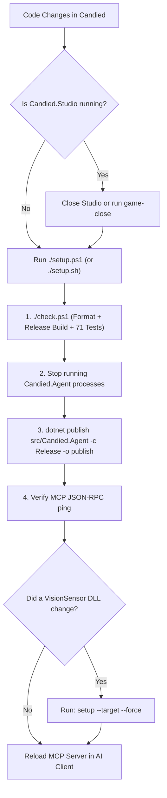

# Updating the Candied MCP Server After Codebase Changes

This guide explains how to rebuild, republish, and reload the **Candied MCP Server** (`Candied.Agent`), **Candied Studio**, and platform Vision sensors (such as `Candied.VisionSensors.UnityMono`) after modifying the Candied repository.

---

## 1. Why `dotnet build` Alone Is Not Enough

Production MCP client configurations (`mcp_config.template.json`) point directly to `./publish/Candied.Agent.exe` for instant startup and zero MSBuild overhead during stdio handshakes. Running `dotnet build` updates `src/Candied.Agent/bin/`, **not** `./publish/Candied.Agent.exe`.

Whenever changes are made to `Candied.Primitives`, `Candied.Core`, `Candied.Infrastructure`, `Candied.Vision*`, `Candied.Platforms.*`, `Candied.Studio`, or `Candied.Agent`, run `./setup.ps1` (Windows) or `./setup.sh` (Linux/macOS).

---

## 2. Step-by-Step Update Workflow



### Run `./setup.ps1` from the Repository Root

```powershell
powershell -ExecutionPolicy Bypass -File .\setup.ps1
```

*(If you already ran `.\check.ps1` and only want a fast republish, pass `-SkipTests`: `.\setup.ps1 -SkipTests`.)*

---

## 3. Deployment Matrix by Modified Module

| Modified Module(s) | Required Action | Notes |
|---|---|---|
| `Candied.Primitives`, `Candied.Core`, `Candied.Infrastructure`, `Candied.Vision`, `Candied.Platforms.*`, `Candied.Agent` | `.\setup.ps1` + Reload MCP Server in IDE | Republishes `./publish/Candied.Agent.exe` and refreshes `tools/list`. |
| `Candied.Studio` | Close `Candied.Studio` -> `.\setup.ps1` | `HttpStudioHostClientAdapter` automatically launches the newly built `Candied.Studio.exe`. |
| `Candied.Vision.Protocol`, `Candied.VisionSensors.UnityMono` | `.\setup.ps1` -> `setup(targetPath, forceReinstall: true)` | Re-deploys the updated sensor `.dll` + protocol `.dll` into `<GameDir>/BepInEx/plugins/Candied.VisionSensor/`. |

---

## 4. Verifying the Published MCP Binary Manually

```powershell
# 1. Verify MCP JSON-RPC ping
'{"jsonrpc":"2.0","id":1,"method":"ping"}' | .\publish\Candied.Agent.exe

# 2. List all advertised MCP tools (Core + Vision + Dynamic Platform Tools)
$resp = '{"jsonrpc":"2.0","id":2,"method":"tools/list"}' | .\publish\Candied.Agent.exe | ConvertFrom-Json
$resp.result.tools | Select-Object name
```
