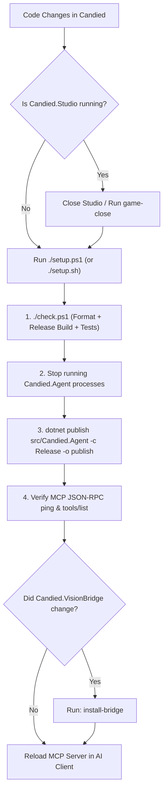

# Updating the Candied MCP Server After Codebase Changes

This guide explains how to rebuild, republish, and reload the **Candied MCP Server** (and its companion components, **Candied Studio** and **Candied VisionBridge**) whenever changes are made to the Candied codebase.

---

## Guida Rapida (Italiano)

Quando vengono apportate modifiche al codice di **Candied**, una semplice `dotnet build` **non basta** se il tuo client MCP (Antigravity, Claude Desktop, Cursor) punta all'eseguibile pubblicato in `./publish/Candied.Agent.exe`.

Ecco la procedura completa per aggiornare lo strumento MCP:

1. **Chiudi eventuali sessioni di gioco attive:** se `Candied.Studio` o il gioco sono aperti, chiudili (oppure esegui `.\publish\Candied.Agent.exe game-close`) per evitare che i file `.exe`/`.dll` siano bloccati da Windows.
2. **Esegui lo script di setup e pubblicazione dalla root del repository:**
   ```powershell
   .\setup.ps1
   ```
   *(Se hai già eseguito i test con `.\check.ps1` e vuoi solo ripubblicare rapidamente il binario MCP, puoi usare `.\setup.ps1 -SkipTests`).*
   Lo script si occupa automaticamente di:
   - Verificare formattazione, compilare l'intera soluzione in modalità `Release` (inclusi `Candied.Agent`, `Candied.Studio` e `Candied.VisionBridge`) ed eseguire i test (`.\check.ps1`).
   - Terminare eventuali processi `Candied.Agent` rimasti in background che bloccherebbero la sovrascrittura dei file.
   - Eseguire `dotnet publish src/Candied.Agent -c Release -o publish` per aggiornare `./publish/Candied.Agent.exe`.
   - Verificare che il nuovo eseguibile risponda correttamente al comando JSON-RPC `ping`.
3. **(Solo se hai modificato `Candied.VisionBridge`) Aggiorna il plugin dentro il gioco:**
   Se le modifiche riguardano il plugin BepInEx in-game (`Candied.VisionBridge` o `Candied.VisionBridge.Protocol`), devi ricopiarlo nella cartella `BepInEx/plugins/` del gioco registrato:
   ```powershell
   .\publish\Candied.Agent.exe install-bridge <NomeGiocoRegistrato>
   ```
4. **Ricarica il server MCP nel tuo client AI (Antigravity / Cursor / Claude):**
   Se sono stati aggiunti, rinominati o modificati dei tool MCP (ad esempio in `McpToolDefinitions.cs`), aggiorna/riavvia la connessione MCP nel pannello MCP Servers del client (o avvia una nuova conversazione) affinché il client riesegua `tools/list` sul nuovo eseguibile.

---

## 1. Why `dotnet build` Alone Is Not Enough

Candied supports two MCP server execution modes (defined in [`mcp_config.template.json`](../mcp_config.template.json)):

| Execution Mode | Command Configured in Client | Output Location Used | What Happens on `dotnet build`? |
|---|---|---|---|
| **Published Binary (Default & Recommended)** | `<REPO>/publish/Candied.Agent.exe` | `./publish/` | **NOT updated.** `dotnet build` only updates `src/Candied.Agent/bin/`, leaving `./publish/Candied.Agent.exe` on the old version. |
| **Dotnet Run (Development Mode)** | `dotnet run --project <REPO>/src/Candied.Agent -c Release` | `src/Candied.Agent/bin/Release/net9.0/` | Updated on `dotnet build -c Release`, unless locked by a running `Candied.Agent` process. |

Because production MCP setups point to `./publish/Candied.Agent.exe` for fast startup and zero MSBuild overhead during stdio handshakes, **you must run `dotnet publish` (via `./setup.ps1` or `./setup.sh`) whenever `Candied.Agent`, `Candied.Core`, `Candied.Decompiler`, `Candied.Workspace`, or `Candied.Primitives` change.**

---

## 2. Step-by-Step Update Workflow



### Step 1: Run `./setup.ps1` (Windows) or `./setup.sh` (Linux/macOS)

From the repository root, run:

```powershell
powershell -ExecutionPolicy Bypass -File .\setup.ps1
```

#### What `./setup.ps1` does under the hood:
1. **Checks Prerequisites:** Confirms the `.NET SDK` is available.
2. **Runs `./check.ps1`:**
   - Checks code style (`dotnet format --verify-no-changes`).
   - Compiles the entire solution in `Release` mode with warnings as errors (`dotnet build --configuration Release /p:TreatWarningsAsErrors=true`). This compiles:
     - `Candied.Agent`
     - `Candied.Studio` (`src/Candied.Studio/bin/Release/net9.0-windows/Candied.Studio.exe`)
     - `Candied.VisionBridge` (`src/Candied.VisionBridge/bin/Release/{net35,net472}/Candied.VisionBridge.dll`)
   - Runs all architecture boundary and unit tests (`dotnet test --configuration Release --no-build`).
3. **Stops Existing `Candied.Agent` Processes:**
   - Automatically stops any running `Candied.Agent` background process so Windows releases file locks on `./publish/Candied.Agent.exe` and its `.dll` dependencies.
4. **Publishes `Candied.Agent` to `./publish/`:**
   - Executes `dotnet publish src/Candied.Agent -c Release -o publish`.
5. **Verifies MCP Stdio Communication:**
   - Pipes `{"jsonrpc":"2.0","id":1,"method":"ping"}` to `.\publish\Candied.Agent.exe` and verifies the `{"result":{}}` JSON-RPC response.

> [!TIP]
> **Fast Republish (`-SkipTests`):**
> If you have already run `./check.ps1` and only need to stop `Candied.Agent` and republish `./publish/Candied.Agent.exe`, pass `-SkipTests`:
> ```powershell
> powershell -ExecutionPolicy Bypass -File .\setup.ps1 -SkipTests
> ```

---

## 3. What to Do Based on Which Module Changed

Not all modules are deployed to the same place. Use this table to check if an extra step is required:

| Modified Module(s) | Required Command | Notes |
|---|---|---|
| `Candied.Primitives`<br>`Candied.Core`<br>`Candied.Decompiler`<br>`Candied.Workspace`<br>`Candied.Agent` | `.\setup.ps1` | Republishes `./publish/Candied.Agent.exe` and all referenced assemblies. |
| `Candied.Studio` | 1. Close `Candied.Studio` if open<br>2. `.\setup.ps1` | `HttpStudioClientAdapter` automatically resolves `src/Candied.Studio/bin/Release/net9.0-windows/Candied.Studio.exe` built during step 2 of `setup.ps1`. |
| `Candied.VisionBridge`<br>`Candied.VisionBridge.Protocol` | 1. `.\setup.ps1`<br>2. `.\publish\Candied.Agent.exe install-bridge <GameName>` | Compiling updates the DLL in `src/Candied.VisionBridge/bin/Release/`, but registered games have a copy of `Candied.VisionBridge.dll` inside `<GameDir>/BepInEx/plugins/`. Run `install-bridge` to overwrite the game's plugin copy. |

---

## 4. Verifying the Updated MCP Binary Manually

After running `./setup.ps1`, you can verify that `./publish/Candied.Agent.exe` advertises the latest MCP tool schemas by running:

```powershell
# 1. Verify MCP ping
'{"jsonrpc":"2.0","id":1,"method":"ping"}' | .\publish\Candied.Agent.exe

# 2. Verify advertised MCP tool names
$resp = '{"jsonrpc":"2.0","id":2,"method":"tools/list"}' | .\publish\Candied.Agent.exe | ConvertFrom-Json
$resp.result.tools | Select-Object name
```

---

## 5. Troubleshooting

* **Error `MSB3027` / `MSB3021` (Could not copy `Candied.Agent.exe` or `Candied.Studio.exe` because it is being used by another process):**
  - Cause: An AI client is still holding `Candied.Agent.exe` open, or `Candied.Studio.exe` is running in the background.
  - Fix: Stop the processes before building/publishing:
    ```powershell
    Stop-Process -Name "Candied.Agent", "Candied.Studio" -Force -ErrorAction SilentlyContinue
    ```
* **AI Client Still Shows Old Tool Names (e.g., `inspect_game_environment` instead of `inspect`):**
  - Cause: MCP clients cache the output of `tools/list` when the MCP server process starts or when a conversation begins.
  - Fix: After running `.\setup.ps1`, click **Refresh / Restart** on the `Candied` MCP server in your IDE's MCP settings (or start a new chat session) so the client re-queries `tools/list` from the newly published binary.
