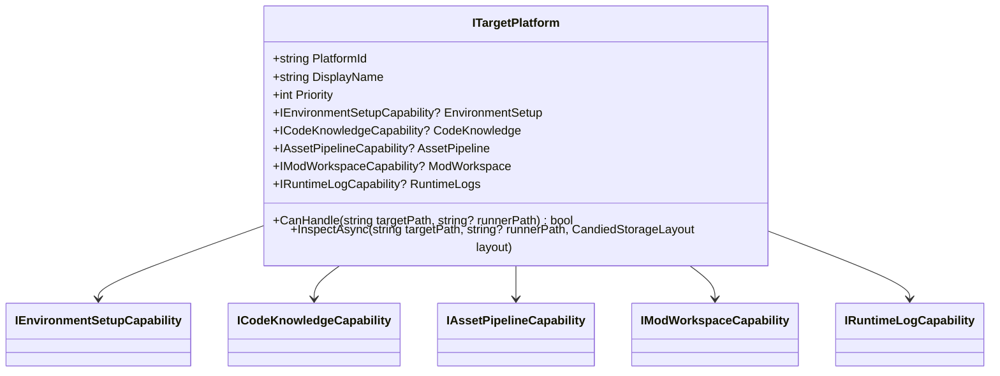

# Module: Candied.Core

## 1. Overview
`Candied.Core` contains the 100% engine-agnostic domain model, composable platform capability traits, shared infrastructure ports, domain error records, and application use cases.

* **Namespace:** `Candied.Core`
* **Target Framework:** `net9.0`
* **Dependencies:** `Candied.Primitives` ONLY
* **Architectural Invariants (Enforced by `Candied.ArchitectureTests`):**
  1. Must NEVER reference `Candied.Infrastructure`, `Candied.Vision`, `Candied.Platforms.*`, `Candied.Studio`, or `Candied.Agent`.
  2. Zero side effects: prohibited from using `System.IO.*` (`File`, `Directory`, `FileStream`) or `System.Diagnostics.Process`.
  3. Completely engine-agnostic: zero domain types named after `Unity`, `BepInEx`, `Mono`, `Il2Cpp`, or `Dll`.

---

## 2. Target Abstraction (`TargetDescriptor`)

Every game—whether a compiled PC directory, a scripted game, or a console ROM/ISO paired with an emulator (`RunnerPath`)—is represented uniformly by `TargetDescriptor`:

```csharp
public sealed record TargetDescriptor(
    TargetId Id,
    string Name,
    string TargetPath,
    string? RunnerPath,
    string PlatformId,
    string PlatformDisplayName,
    string Architecture,
    string? EngineVersion,
    string? RuntimeFramework,
    ModLoaderStatus ModLoader,
    IReadOnlyList<PlatformCapability> Capabilities,
    IReadOnlyList<DiscoveredCodeModule> CodeModules,
    IReadOnlyDictionary<string, string> Metadata,
    IReadOnlyList<string> Warnings
);
```

* **`PlatformCapability` flags:** `EnvironmentSetup`, `CodeKnowledge`, `AssetPipeline`, `ModWorkspace`, `RuntimeLogs`, `InputProfileExtraction`, `LiveVisionSensor`.
* **`CodeModuleTier`:** Categorizes discovered code modules (`CoreLogic`, `ModularLogic`, `AuxiliaryOrThirdParty`) whether they are managed `.dll` modules, IL2CPP metadata dumps, `.pck` script packs, or Lua archives.
* **`CandiedStorageLayout`:** Pure string-only path calculator implementing the **Three-Zone Storage Architecture**:
  * **Zone 1:** Target game/ROM location (kept clean; any loader files tracked in `.candied_manifest.json`).
  * **Zone 2:** Mod source workspaces (`<WorkspaceRoot>/mods/<ModName>/`).
  * **Zone 3:** Reverse-engineering & perception artifacts (`<WorkspaceRoot>/.candied/games/<TargetName>/` containing `extracted/`, `index.db`, `docs/`, `assets/`, `screenshots/`, `controls.json`, plus shared loader caches in `.candied/cache/<loaderId>/`).

---

## 3. Composable Platform Capability Traits (`Candied.Core.Capabilities`)

Instead of forcing every engine into a rigid monolithic interface, each `ITargetPlatform` exposes only the capabilities supported by that engine:



* **`IEnvironmentSetupCapability`:** Reversibly provisions and rolls back mod loaders and in-game Vision sensors (`ProvisionAsync`, `RollbackAsync`).
* **`ICodeKnowledgeCapability`:** Extracts/decompiles/dumps a named `moduleName` into Zone 3 (`extracted/<ModuleName>/`) and populates `ISymbolIndex`.
* **`IAssetPipelineCapability`:** Discovers and extracts sprites, textures, text, or data containers offline into Zone 3 (`assets/`).
* **`IModWorkspaceCapability`:** Scaffolds mod projects in Zone 2 (`ScaffoldModAsync` with extensible `PlatformOptions`) and builds/packages/deploys them (`BuildModAsync`).
* **`IRuntimeLogCapability`:** Resolves default runtime log paths and parses structured `LogEntry` records (`ReadRecentLogsAsync`).
* **`IPlatformToolProvider` & `IPlatformGuideProvider`:** Allow platform plugins to dynamically register engine-specific MCP/CLI tools (e.g., `unity-add-reference` for `unity.mono`) and markdown modding playbooks without polluting `Candied.Core`.

---

## 4. Shared Outbound Ports (`Candied.Core.Ports`)

* **`ITargetPlatformRegistry`:** Resolves the highest-priority `ITargetPlatform` matching `(targetPath, runnerPath)` (falling back to `generic.window` for unknown games/emulators) and resolves build platforms for mod projects.
* **`ISymbolIndex`:** Universal symbol and source code index supporting both Roslyn C# AST trees (`IndexCSharpSourceTreeAsync`) and pre-extracted symbols from non-C# platforms (`IndexExtractedSymbolsAsync`), plus `SearchSymbolsAsync`, FTS5 `SearchCodeAsync`, and `GetTypeDetailAsync`.
* **`IAssetIndex`:** Paginated offline catalog for discovered game assets (`IndexAssetsAsync`, `SearchAssetsPageAsync`).
* **`IDocumentationGenerator`:** Renders Zone 3 Knowledge Hub documents (`GAME_OVERVIEW.md`, `NAMESPACES.md`, `SYMBOLS_INDEX.json`, `RESEARCH.md`).
* **`ITargetProcessManager`:** OS process inspection, launch, and graceful termination.

---

## 5. Pure Domain Analysis & Use Cases

* **`TypeMemberSourceExtractor`:** Pure brace-balanced source extractor enabling `type(..., memberFilter: "...")` to return only matching methods/fields/properties without flooding LLM context windows.
* **Use Cases (`Candied.Core.UseCases`):**
  * *Target & Environment:* `InspectTargetUseCase`, `SetupTargetEnvironmentUseCase`, `RollbackTargetEnvironmentUseCase`, `SaveResearchNotesUseCase`.
  * *Code & Symbols:* `ExtractCodeModuleUseCase` (extracts module -> updates SQLite -> regenerates Knowledge Hub), `SearchSymbolsUseCase`, `SearchCodeUseCase`, `GetTypeDetailUseCase`.
  * *Assets, Modding & Logs:* `IndexAssetsUseCase`, `DiscoverAssetsUseCase`, `ExtractAssetsUseCase`, `ScaffoldModUseCase`, `BuildModUseCase`, `ReadRuntimeLogsUseCase`.
