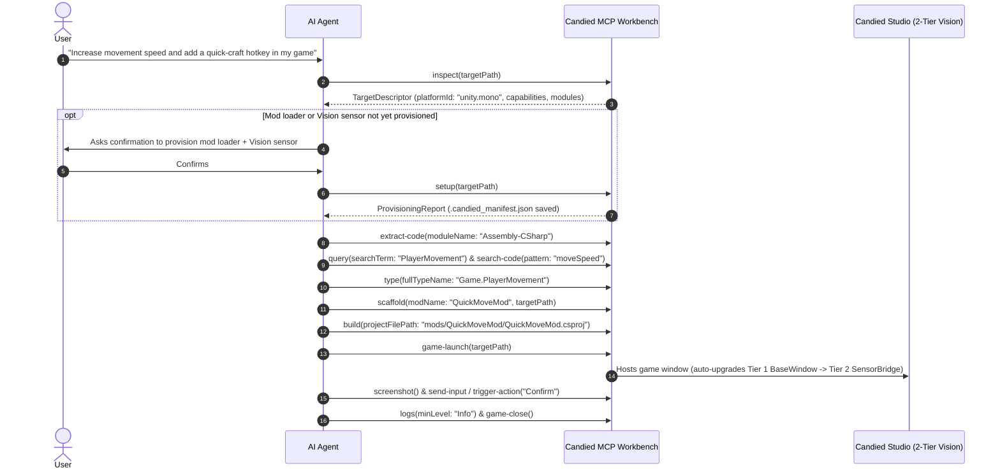

# Use Case Scenarios

This document outlines end-to-end user and AI agent workflows enabled by Candied's multi-platform modding and 2-Tier live vision architecture.

---

## Scenario 1: Creating a Gameplay or Accessibility Mod (PC Game)

**Goal:** Describe a desired gameplay or UI improvement in plain language and turn it into a verified, reversible mod.

---

## Scenario 2: Live Inspection & Control Mapping on Any Window or Emulator

**Goal:** Visually inspect, map controls, and navigate a custom C++ game or an emulated console ROM (`targetPath` + `runnerPath`) that has **no** in-game sensor plugin.

1. The user or agent calls `inspect(targetPath: "C:/Roms/Game.iso", runnerPath: "C:/Emulators/pcsx2-qt.exe")`. Candied resolves `generic.window` with `LiveVisionSensor` support via Studio Tier 1.
2. Calling `game-launch(targetPath, runnerPath)` opens `Candied.Studio`, embeds the emulator viewport in **Tier 1 (`BaseWindow`)** mode, and captures screenshots immediately via Win32 `PrintWindow`/`BitBlt`.
3. The user or agent defines semantic bindings (`Confirm` -> Gamepad `South`, `Pause` -> Gamepad `Start`) via `set-controls` or Studio's **🎮 Comandi** tab (`controls.json`), then interacts cleanly via `trigger-action` or `send-input(channel: "gamepad", ...)` verified by follow-up `screenshot` calls.

---

## Scenario 3: Diagnosing Mod Conflicts or Runtime Exceptions

1. The user reports an unexpected behavior or crash when loading mods.
2. The agent invokes `logs(targetPath, minLevel: "Warning")` to retrieve parsed multi-line stack traces via the target platform's `IRuntimeLogCapability`.
3. Using `search-code` and `type` against extracted modules in Zone 3, the agent pinpoints the failing hook or missing reference without modifying the game installation.
