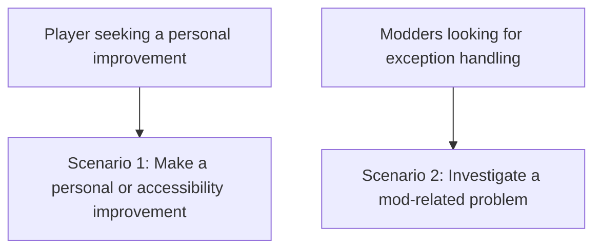
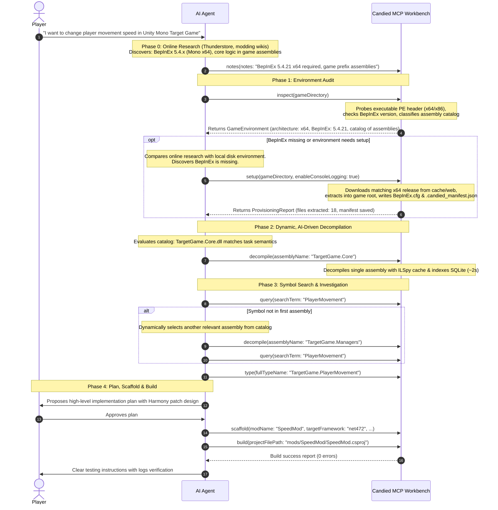

# Use Case Scenarios

This document details end-to-end use case scenarios for the **Candied** application. It outlines how different archetypes of users might interact with the project.

---

## 1. Personas

* **Player seeking a personal improvement:** Wants to adapt a game's behavior or interface to better suit their preferences, with little or no programming experience.
* **Modders looking for exception handling:** Supports a collection of mods and needs to investigate failures reported by users.

---

## 2. Scenarios

### Scenario 1: Make a personal or accessibility improvement

**Persona:** A player who wants to reduce friction or improve accessibility in a game but may not know how to create a mod.

**Goal:** Describe a desired change in ordinary language and get help turning it into a safe, testable mod.

#### Progressive Interaction Flow

**Main flow:**
1. The player explains what should change, why it matters, and any constraints.
2. The assistant searches online for relevant information (existing mods, game mechanics, recommended BepInEx version, and target runtime). The findings are confirmed with the player and persisted using `notes` (`RESEARCH.md`).
3. The assistant audits the game environment via `inspect` (confirming BepInEx version, architecture, and .NET target framework against the online research, and reviewing the classified assembly tiers).
4. If BepInEx is missing or misconfigured, the assistant automatically provisions the environment via `setup`. Candied selects the architecture-matched release (`x64`/`x86`), leverages local caching in `.candied/cache/bepinex/`, pre-configures logging in `BepInEx.cfg`, and creates an uninstallation manifest (`.candied_manifest.json`) in the game directory. If uninstallation or recovery is needed, `rollback` cleanly restores the vanilla state.
5. The assistant investigates the game behavior by dynamically selecting and decompiling only the necessary assemblies via `decompile` (driven by the agent's contextual evaluation of the catalog), querying classes and methods with `query` and `type`.
6. The assistant proposes a high-level implementation plan to the player and waits for approval. The high-level plan and low-level patch designs are stored as documentation for the modding task.
7. The assistant scaffolds the mod via `scaffold` with the verified target framework, writes Harmony patches, and builds the project via `build`. Any compiler errors are explained in actionable terms.
8. The player receives clear instructions for trying the mod and checking that the behavior is as intended via `logs`.

**Expected outcome:** The player can evaluate the change without needing to understand the game's internal implementation first. The assistant calls out uncertainty and does not claim that the mod is safe or successful without evidence.

---

### Scenario 2: Investigate a mod-related problem

**Persona:** A modpack maintainer or player diagnosing a crash, freeze, or unexpected behavior.

**Goal:** Narrow down the cause and identify a practical next step.

**Main flow:**
1. The maintainer provides the available error information and context, such as when the problem occurs and which mods are involved.
2. The assistant examines the relevant diagnostic output and identifies meaningful errors, warnings, and references to mods via `logs`.
3. The assistant distinguishes confirmed evidence from possible causes and suggests focused checks, such as reproducing the issue or temporarily isolating a mod.
4. The maintainer uses the findings to fix, report, or further investigate the problem.

**Expected outcome:** The maintainer gets a concise, evidence-based explanation and actionable next steps rather than an unfiltered dump of diagnostic output or an unsupported claim about the cause.

---

## 3. Cross-Scenario Expectations

These expectations apply across the scenarios and can be used as shared acceptance criteria:

* **Grounded discovery:** Recommendations about game behavior are based on inspected evidence; uncertainty is stated rather than hidden.
* **Focused changes:** Implementations address the requested behavior without unrelated modifications.
* **Actionable feedback:** Build and diagnostic failures identify what failed and provide useful context for the next step.
* **User control:** Users can review proposed changes and retain control over consequential actions.
* **Verifiable outcomes:** Completion reports distinguish implemented changes, checks actually run, and behavior that still requires in-game verification.
* **Appropriate guidance:** Explanations and next steps are useful to both new mod creators and experienced developers.

---
